<div align="center">
  
</div>

```text
 ███╗   ███╗ ██╗  ██╗      maruthi@hoboken
 ████╗ ████║ ██║ ██╔╝      ───────────────────────────────────────────────────
 ██╔████╔██║ █████╔╝       OS ········ AI engineer · MS @ Stevens Institute of Technology
 ██║╚██╔╝██║ ██╔═██╗       Host ······ PULSE.AI Lab · Stevens CPE
 ██║ ╚═╝ ██║ ██║  ██╗      Kernel ···· LLM agents · applied ML · production AI platforms
 ╚═╝     ╚═╝ ╚═╝  ╚═╝      Shell ····· build fast, measure before believing
                           Route ····· Kadapa → Chennai → California → Hyderabad → Hoboken
                           Packages ·· fintel, qml-oncology  (PyPI)
                           GPU ······· AMD MI300X · 2.93× measured, one change at a time
                           Theme ····· so much more is coming
```

<div align="center">

[](https://maruthikunchala.netlify.app)
[](https://www.linkedin.com/in/mcsk)
[](https://huggingface.co/spaces/lablab-ai-amd-developer-hackathon/ROCKET-mi300x)
[](https://pypi.org/user/KMaruthi2002/)

</div>

<br>

## `▸ featured.builds`

<table align="center" border="0" cellspacing="0" cellpadding="6">
  <tr>
    <td><a href="https://github.com/KMaruthi2002/rocket"></a></td>
    <td><a href="https://github.com/KMaruthi2002/EIDOS"></a></td>
  </tr>
  <tr>
    <td><a href="https://github.com/KMaruthi2002/KEPLER"></a></td>
    <td><a href="https://github.com/KMaruthi2002/REWIND"></a></td>
  </tr>
  <tr>
    <td><a href="https://github.com/KMaruthi2002/QuanTriage"></a></td>
    <td><a href="https://github.com/KMaruthi2002/fintel"></a></td>
  </tr>
  <tr>
    <td><a href="https://github.com/KMaruthi2002/PyExplain"></a></td>
    <td><a href="https://github.com/KMaruthi2002/F1_Dashboard"></a></td>
  </tr>
</table>

<p align="center">
  <sub>also: <a href="https://github.com/KMaruthi2002/universal-llm-skills">universal-llm-skills</a> · 118 style-neutral skills any LLM can use &nbsp;//&nbsp; <a href="https://github.com/siddhant-rajhans/DreamStudio-Vision-to-story">DreamStudio</a> · a real-time cinematic story director on Gemini Live, Imagen 4, Veo 3.1 and Lyria 2</sub>
</p>

<br>

## `▸ stack`

<div align="center">


</div>

<br>

## `▸ telemetry`

<div align="center">
  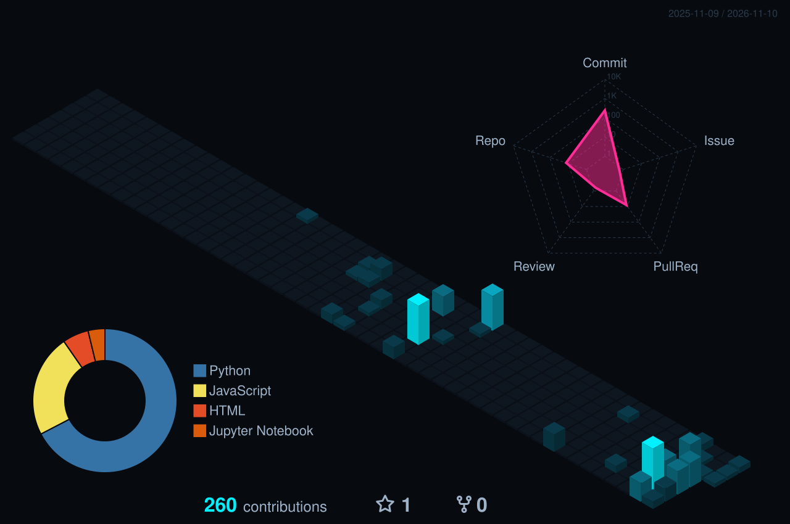
</div>

<div align="center">
  
</div>

<div align="center">
  <picture>
    <source media="(prefers-color-scheme: dark)" srcset="https://raw.githubusercontent.com/KMaruthi2002/KMaruthi2002/output/github-snake.svg">
    <source media="(prefers-color-scheme: light)" srcset="https://raw.githubusercontent.com/KMaruthi2002/KMaruthi2002/output/github-snake-light.svg">
    
  </picture>
</div>

<br>

<div align="center">
  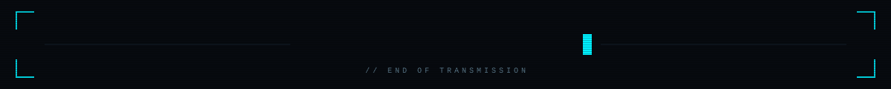
</div>
